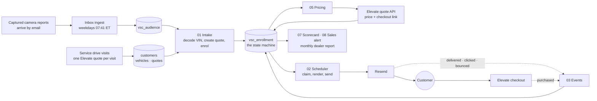

# Service Drive VSC program, engineering handoff

> Written 12 November 2026 for the handoff to a dedicated owner. The styled version is the
> artifact at https://claude.ai/artifact/C9Vk7wm5DJ4yz4P4kcA6g1; this file is the copy that
> lives with the code. The operations manual is `.claude/skills/service-drive-vsc-follow-up/SKILL.md`.

## What this is

A co-branded email program that sells a DriveOne vehicle service contract (VSC) to a dealership's own customers, sent as the dealership. Every recipient gets a real, VIN-rated monthly price in the first email and a checkout link that pre-fills from their record. Ten emails over 60 days, then it stops. Nobody is called.

It is a beta that has been hardened in production for one dealership, Ferrario Ford in Elmira NY, under three audiences. The second dealership on file (Bob Johnson) is built and paused. The whole thing was designed and operated through Claude Code sessions against the repo, with the skill file as the operations manual. That is the first thing a dedicated owner should change: the knowledge needs to live with a person and a runbook, not a chat history.

- **3 live campaigns.** Service drive, recall visitors, drive-by. Same engine, separate copy, From address and pace.

- **1,328 people in sequence.** 1,064 service drive, 32 recall, 232 drive-by, all priced. First sends of the relaunch today, 9 am Eastern.

- **2,069 quotes created from camera data.** 164 recall + 778 drive-by quoted so far by the engine itself; 1,143 drive-by still queued at 50 an hour.

- **7 n8n workflows per campaign.** Generated from one JSON file so the automation can never drift from the creative.

## System map

Three systems, one database. The Elevate app (getelevatewarranty.com) owns customers, vehicles and quotes in Supabase; the campaign tables live in the same project so audience selection is one SQL statement. n8n Cloud runs the pipeline on hourly crons. Resend delivers the mail and reports back by webhook. Captured's camera data arrives by email and is loaded into an audience table by a scheduled job.

| Component               | Role                                                                                                                             | Where                                                                                                                   | Credential / owner                                                                                                                                            |
|-------------------------|----------------------------------------------------------------------------------------------------------------------------------|-------------------------------------------------------------------------------------------------------------------------|---------------------------------------------------------------------------------------------------------------------------------------------------------------|
| **Supabase**            | System of record for both the app data and campaign state. One project, not two.                                                 | Project bbvkqwcapqsytrdrubci (elevate-production)                                               | Service role in n8n (Postgres account); a scoped role vsc_campaign with insert on customers, vehicles, quotes |
| **n8n Cloud**           | Runs every workflow. State is never kept in n8n; it is disposable.                                                               | Workflows tagged driveone-vsc + dealer:\<id\>                           | n8n account; variables RATING_API_KEY, RESEND_API_KEY, SLACK_ALERT_WEBHOOK            |
| **Elevate partner API** | The only source of prices and customer links. GET /api/partners/quotes/{id}.                             | getelevatewarranty.com (Stephen's team)                                                                                 | x-captured-api-key header, value in n8n only                                                                                          |
| **Resend**              | Sending, List-Unsubscribe headers, delivery/click/bounce/complaint webhooks.                                                     | Domains ferrario.driveoneprogram.com, ferrario.driveoneservice.com      | Resend account; one account-wide webhook → the ferrario-ford 03 endpoint                                                                                      |
| **Vercel DNS**          | Hosts the driveoneprogram.com / driveoneservice.com zones the sending subdomains hang off.                                       | Vercel team                                                                                                             | Vercel account                                                                                                                                                |
| **NHTSA vPIC**          | Free VIN decode, batches of 50, no key. Used only for camera-sourced VINs.                                                       | vpic.nhtsa.dot.gov                                                                              | None                                                                                                                                                          |
| **Microsoft 365**       | Captured emails reports to ryan@kovara.ai. The ingest job reads that mailbox.                                                    | Kovara tenant                                                                                                           | Ryan's mailbox (this is the weak link; see section 08)                                                                                                        |
| **MetricBridge**        | Dealer-level reporting product; partners.id here equals dealers.source_id there. | MetricBridge MCP                                                                                                        | Read only from this program                                                                                                                                   |
| **GitHub**              | Everything is generated from the repo: emails, workflows, SQL, checks.                                                           | insureifyRyan/driveone-design-system, branch claude/sweet-newton-nbgj9b | Needs merging to main as part of the handoff                                                                                                                  |

## Data model

Campaign tables sit beside the app's tables in the same Postgres. The enrollment row is the truth: who is on which step, what they were quoted, when they are next due. Identity is `customer_key = sha256(dealer_id || ':' || lower(email))`, so replaying any feed is idempotent.

| Table                                                                                                        | Purpose                                                                                                                                                                       | Notes                                                                                                                                                                      |
|--------------------------------------------------------------------------------------------------------------|-------------------------------------------------------------------------------------------------------------------------------------------------------------------------------|----------------------------------------------------------------------------------------------------------------------------------------------------------------------------|
| vsc_enrollment                                                                       | One row per person per campaign. The state machine: status, current_step, next_send_at, exit_reason, vehicle snapshot, price fields, checkout links, pricing and send guards. | Check constraint: cannot pass step 0 without monthly_payment.                                                                                      |
| vsc_send_log                                                                         | Append only, one row per send, unique on (enrollment_id, step).                                                                                                               | Second line of defence against a double send. Carries provider_message_id for joining Resend events.                                               |
| vsc_suppression                                                                      | Permanent do-not-contact per (dealer_id, customer_key).                                                                                                                       | Outlives any enrollment. Re-checked inside the send claim, not only at intake.                                                                                             |
| vsc_email_event                                                                      | Delivered and clicked events from Resend, append only.                                                                                                                        | Count distinct provider_message_id, never count(\*): webhooks retry.                                                       |
| vsc_email_template                                                                   | The 10 rendered HTML templates per campaign with {{merge_tags}}.                                                                                      | Published from email/dist by scripts/publish-templates.mjs.                                                                |
| vsc_audience                                                                         | Camera-sourced people (recall and drive-by buckets) waiting for a quote: VIN, email, bucket, est_mileage, quote_id, quote_attempts, quote_error.                              | Fed by the inbox ingest; drained by 01 Intake in audience mode.                                                                                                            |
| vsc_inbox_ingest                                                                     | Ledger of every Captured email processed, keyed by Outlook message id.                                                                                                        | Stops a report being loaded twice.                                                                                                                                         |
| customers, customer_vehicles, quotes | The app's own tables. For the service drive they are the audience source (one quote per visit). For the camera buckets the engine inserts into them to create the quote.      | A customers insert trigger calls the app webhook which mints the Clerk user; a quotes insert trigger numbers the contract. |

Also present and historical: vsc_rate\_\* and vsc_rates_export (a local copy of the rate card that proved unable to reproduce live quotes, kept for sanity checks only), vsc_respread_audit, vsc_name_scrub\_\*, vsc_template_patch_log, vsc_sale_announced. Column-level detail is in references/data-contracts.md.

## The pipeline, step by step

Every campaign is seven workflows generated by `n8n/build-workflows.mjs` from the dealer file (`brand/dealers/<id>.json`) and the copy deck (`email/copy/*.json`). Workflow numbers are stable across dealers.

| Workflow           | Trigger            | What it does                                                                                                                                                                                                                                                                                                                                                                                                                                                                                                                                                                                                                           |
|--------------------|--------------------|----------------------------------------------------------------------------------------------------------------------------------------------------------------------------------------------------------------------------------------------------------------------------------------------------------------------------------------------------------------------------------------------------------------------------------------------------------------------------------------------------------------------------------------------------------------------------------------------------------------------------------------|
| **01 Intake**      | Hourly :23         | **Service drive mode:** one atomic insert … select … on conflict do nothing from quotes ⋈ customers ⋈ customer_vehicles for the partner, applying eligibility in SQL. **Audience mode** (camera buckets): links vsc_audience rows to existing dealership quotes by VIN or email; for the rest decodes VINs through NHTSA, inserts customer → vehicle → quote in the app tables, stores the quote id, then enrols. Deals new people onto Tue–Fri send slots at a configured rate. Respects a cohort ceiling, so raising initial_cohort is the enrolment switch. |
| **05 Pricing**     | Hourly :41         | For enrolled rows without a price: calls the Elevate quote endpoint (2 requests per 1.1 s), picks the lowest financed monthly option, writes price, term, coverage and the guided_purchase_link. Five attempts then leaves the row unpriced and therefore unsent.                                                                                                                                                                                                                                                                                                                                              |
| **02 Scheduler**   | Hourly :07         | The send switch. Gate on day, hour and daily cap; claim due rows with for update skip locked; refuse anything without a price, a link, or a link expiring inside 30 minutes; render the step's template with merge tags; POST to Resend with dealer_id/campaign_id tags; log the send; advance the step. Next send date is computed from enrolment date, so a late run never compresses the cadence.                                                                                                                                                           |
| **03 Events**      | Webhook            | Receives Resend events and internal checkout events. Purchase, unsubscribe, permanent bounce, complaint → exit (and suppress where appropriate). Delivered and clicked → vsc_email_event. Transient bounces do nothing. Reads the campaign from the message tags so one Resend webhook serves every campaign.                                                                                                                                                                                                                                                                                                  |
| **04 Error**       | On any failure     | Posts to Slack. Named as the error workflow by all others. The webhook URL in \$vars has been truncated or exposed at different points; verify it posts before trusting it.                                                                                                                                                                                                                                                                                                                                                                                                                                    |
| **06 Review**      | Hourly :41         | Emails a human the rows held for manual attention (commercial / business-registered vehicles that carry a surcharge).                                                                                                                                                                                                                                                                                                                                                                                                                                                                                                                  |
| **07 Scorecard**   | Monday 08:10 local | One roll-up query to one HTML digest: enrolled, priced, sent by step, delivered, clicked, purchased, exits by reason, suppressions, errors, and for the buckets how far quoting has got. Sends in a quiet week on purpose. Opens are not tracked, by decision.                                                                                                                                                                                                                                                                                                                                                                         |
| **08 Sales alert** | Hourly             | One shared workflow across dealers: a quote flipping to payment_status = completed is posted to Slack and marked in vsc_sale_announced.                                                                                                                                                                                                                                                                                                                                                                                                                                                |
| **09–11 SMS**      | Not deployed       | Sendblue layer (shared sender, unsold nurture, inbound/STOP sweep) is built in the generator but has never been deployed. The drive-by deck ships no SMS on purpose (no consent for text).                                                                                                                                                                                                                                                                                                                                                                                                                                             |

### The operating rhythm around it

- **Weekdays 07:41 ET, Captured inbox ingest.** Reads new mail from Captured's two senders, extracts VIN+email rows from attachments, dedupes against audience, enrolments and the partner's quotes, loads survivors into `vsc_audience`, ledgers the message. Recipe: `references/captured-inbox-ingest.md`.
- **Monday 08:10 ET, scorecard** per campaign to ryan@kovara.ai.
- **1st of the month 13:17 ET, dealer report.** Refreshes the dealer-facing program report, republishes it, renders a PDF and emails it for forwarding. Recipe: `references/monthly-dealer-report.md`.

The ingest and the monthly report are currently Claude scheduled tasks bound to one Claude Code session because that is the only place the Microsoft 365, Supabase and Gmail connectors meet. That works, and it is the least durable piece of the system. Section 08 covers the replacement.

## The three Ferrario campaigns

Same engine three times. Each is its own dealer file, copy deck, campaign id, From address and pace, and shares the partner id, so one person can never be enrolled twice across them.

<table style="width:100%;">
<colgroup>
<col style="width: 16%" />
<col style="width: 16%" />
<col style="width: 16%" />
<col style="width: 16%" />
<col style="width: 16%" />
<col style="width: 16%" />
</colgroup>
<thead>
<tr class="header">
<th>Campaign</th>
<th>Who</th>
<th>Source</th>
<th>Sent as</th>
<th>Pace</th>
<th>Today</th>
</tr>
</thead>
<tbody>
<tr class="odd">
<td><strong>Service drive</strong> 
ferrario-ford 
ff_postro_vsc_2026</td>
<td>Customers with a service visit on file and no contract. "You were in with us on October 28."</td>
<td>Elevate quotes for the partner (1,244 in window)</td>
<td>Ferrario Ford Service 
service@ferrario.driveoneprogram.com</td>
<td>90 new a day, cap 200/day, Tue–Fri 9–4 ET</td>
<td>live 
1,064 active, 1,057 priced</td>
</tr>
<tr class="even">
<td><strong>Recall visitors</strong> 
ferrario-ford-visited 
ff_visited_vsc_2026</td>
<td>People Captured emailed whose vehicle the lot cameras then recorded. "The recall was the free part."</td>
<td>vsc_audience bucket visited, 165 vehicles</td>
<td>Ferrario Ford Service 
same domain</td>
<td>45 new a day, cap 100</td>
<td>live 
164 quoted, 32 active (56 eligible)</td>
</tr>
<tr class="odd">
<td><strong>Drive-by</strong> 
ferrario-ford-list 
ff_list_vsc_2026</td>
<td>Plate-identified owners Captured emailed, never on the lot, not in service records. "We have not met. Here is a number anyway." No relationship claimed.</td>
<td>vsc_audience bucket list, 1,926 with a VIN</td>
<td>Ferrario Ford with DriveOne Service 
service@ferrario.driveoneservice.com (new domain, warming)</td>
<td>10 new a day, cap 60, max 20 per run</td>
<td>live, ramping 
778 quoted, 232 active, 1,143 queued</td>
</tr>
</tbody>
</table>

n8n workflow ids. Service drive: 01 AJYWBfCCu66B6x4n, 02 wcFRhWQ6LnJEVVhP, 03 ZobQxDEJeJiUc0FJ, 05 UEaYKvcHnQCL2rEZ. Recall: 01 UC9l4GQBJXIRKkJI, 02 RzVjZKkRBlRwAJP8, 03 va0yXs7py01zDqP4, 05 bMnYyzz1jenXbx5s, 06 DDPUoVa4fKfMIWV3, 07 6VTNxuYb2zJhzY9f. Drive-by: 01 JDB3DiprdnKBN8Op, 02 UbvZup3o9jKdfouN, 03 sG5m7QsBx2Wmt620, 05 Inb7aK3fnFjEwsry, 06 C8cxptc5ccF18tXr, 07 hSnGMsvgFwEwEv3D. Pause a campaign: set its 01 cohort_limit to 0. Stop sends: unpublish its 02.

### How the camera data became two audiences

Captured emailed 10,256 plate-identified owners under the Ford and Jeep names between June and August and ran four cameras on the lot through 2 November (832 plate reads, 165 vehicles matched to 164 emailed people, 584 visit days). The reconciliation workbook was deduped against the dealership's service records, existing enrolments and partner quotes: 545 were already in the service drive campaign, 7,654 had no VIN and cannot be quoted, leaving 165 recall visitors and 1,893 drive-by owners. Those two lists are what `vsc_audience` holds. The workbook itself stays out of the repo (customer data).

## Rules that must not change

Each of these was learned from a real failure. Change the mechanism if you like; keep the guarantee.

**Never compute a price locally.**

The exported rate card reproduces itself and still does not reproduce live quotes (rating is VIN-keyed and class-aware). A local price came out 10–20% under checkout. Always ask the API; `monthly = contract_price × 0.95 / term` is for sanity checks only.

**Never build a customer link locally.**

The quote endpoint returns `guided_purchase_link`, `short_link`, `quote_link`. Buy buttons use those, in that order of preference.

**Nothing sends without a price and a destination.**

Enforced three times: a check constraint on the row, the scheduler's claim query, and the build-time template guard that fails on an unresolved merge tag.

**State lives in Postgres, never in n8n.**

No Wait-node chains. The atomic claim plus the unique send log is what makes a double send impossible and a restart harmless.

**Eligibility is fixed and explicit.**

Model year within 12 years; nothing above the F-150 class (F-250+, RAM/Dodge 2500+, GM 2500/3500, E-350/E-450, big vans) is rated or emailed, by the dealer's instruction; mileage estimate for camera lists is 15,000 a year capped at 145,000 because the rating stops at 150,000; checkout re-prices on the real odometer.

**Only permanent bounces suppress. Opens are never tracked.**

Transient bounces clear on their own; suppressing on them burns real customers. Opens measure Apple Mail's prefetch, not readers; the verify script fails if a scorecard grows an "Opened" row.

**Customer data stays in the database.**

No names, emails, VINs or plates in the repo, in dealer-facing reports, or in chat. The dealer report is aggregates only.

## Working in the repo

#### Layout

- `brand/dealers/*.json` one file per campaign: identity, colours, From, cadence, caps, intake mode, copy deck.
- `email/copy/*.json` the decks (10 emails each). `email/build.mjs` renders `email/dist` and client previews.
- `n8n/build-workflows.mjs` generates workflow JSON; `n8n/verify.mjs` asserts behaviour (runs the generated send code against a fake clock).
- `scripts/check.mjs` pre-send guard on emails; `scripts/publish-templates.mjs` template SQL; `scripts/to-n8n-sdk.mjs` JSON → n8n SDK code for deployment.
- `docs/` deliverability, DNS, Supabase, n8n setup, adding a dealership. `reports/` dealer report template.

#### Commands

    npm run build          # emails + workflows + verify + check, all dealers
    npm run build:ferrario-ford-list   # one campaign
    node n8n/verify.mjs ferrario-ford  # 25 behavioural checks
    node scripts/to-n8n-sdk.mjs n8n/workflows/<id>/02-scheduler.json

Deployment today is manual: convert to SDK code, swap credential references, create or update in n8n, set timezone and error workflow, publish. Node-level fixes are applied with `setNodeParameter` and a republish.

### Adding a dealership

Copy a dealer file, set partner id, colours, address, From and cadence; verify the sending subdomain in Resend (four DNS records, see `docs/DELIVERABILITY.md`); build; publish templates; deploy the seven workflows; ramp. `docs/ADDING-A-DEALERSHIP.md` has the checklist. Budget a week for domain warm-up before volume.

## Where the next owner can make it better

In rough priority. The first three are structural; the rest are hygiene.

| Area                                 | Today                                                                                                                                                                                                              | Suggested direction                                                                                                                                                                                                                                                                                                                                                                                                                    | Priority                              |
|--------------------------------------|--------------------------------------------------------------------------------------------------------------------------------------------------------------------------------------------------------------------|----------------------------------------------------------------------------------------------------------------------------------------------------------------------------------------------------------------------------------------------------------------------------------------------------------------------------------------------------------------------------------------------------------------------------------------|---------------------------------------|
| **Captured data intake**             | Reconciliation workbooks arrive as email attachments to one person's mailbox and are parsed by a scheduled job. External SharePoint links cannot be read at all.                                                   | Agree a machine feed with Captured: a signed CSV drop to an S3/Supabase storage bucket, or an API. Replace the mailbox parser with an ingest function that validates a fixed schema. Keep the `vsc_inbox_ingest` ledger idea.                                                                                                                                                                                                          | high    |
| **Scheduled jobs living in Claude**  | Inbox ingest and the monthly report are Claude scheduled tasks bound to one session.                                                                                                                               | Move both to n8n (the Microsoft Graph node can read the mailbox) or a small worker with its own credentials. Nothing operational should depend on a chat session existing.                                                                                                                                                                                                                                                             | high    |
| **Reporting**                        | A weekly HTML scorecard per campaign and a monthly hand-assembled dealer report. Numbers are correct but there is no self-serve view.                                                                              | Point Power BI (or Metabase) at Supabase through the Postgres connector against a read-only reporting schema: views over `vsc_enrollment`, `vsc_send_log`, `vsc_email_event` and `quotes`, keyed by dealer and campaign. Keep the scorecard as the alert channel; retire the hand-built report once the dashboard is trusted. Mind the two measurement rules: delivery as a share of trackable sends, distinct message ids for clicks. | medium |
| **Deployment**                       | Workflow JSON is converted to SDK code and pushed through the MCP by hand; the repo and the instance can drift.                                                                                                    | CI that builds, verifies and publishes through n8n's public API on merge, with a drift check comparing live workflow hashes to the repo.                                                                                                                                                                                                                                                                                               | medium |
| **Alerting**                         | 04 posts to a Slack webhook that has been truncated once and exposed in a screenshot once. 07 is the only reliable signal a human gets.                                                                            | Rotate the webhook, confirm 04 posts on a forced failure, and add a dead-man check (no 02 run in 3 hours during the window → page).                                                                                                                                                                                                                                                                                                    | medium |
| **Secrets**                          | A Supabase secret key (`sb_secret_jN9z…`) and the Slack webhook are due for rotation. The `customer-events` trigger definition carries the app's webhook secret in plain text, readable by anyone with SQL access. | Rotate both now; move the trigger's secret to Vault or a security-definer function.                                                                                                                                                                                                                                                                                                                                                    | high    |
| **Rating gaps**                      | A few ordinary vehicles return no financed option (a 2018 RAM 1500, a 2018 Cruze at 100k, a 2017 RAV4 at 60k). The engine retries five times and leaves them unsent.                                               | Raise with Stephen's team; add a weekly list of unpriceable vehicles to the scorecard so the gap is visible rather than silent.                                                                                                                                                                                                                                                                                                        | medium |
| **Calendar**                         | No holiday list. Thanksgiving sends were moved by hand.                                                                                                                                                            | Add `sending.holidays` to the dealer file and the dealing query.                                                                                                                                                                                                                                                                                                                                                                       | low     |
| **Click tracking on the new domain** | The drive-by domain's click tracking could not be enabled by API; only via the Resend dashboard.                                                                                                                   | Enable the custom tracking subdomain (`links.ferrario.driveoneservice.com`) as was done for the first domain.                                                                                                                                                                                                                                                                                                                          | low     |
| **SMS layer**                        | Built, never deployed. Consent only exists for the service drive audience.                                                                                                                                         | Decide whether it ships at all before spending time on it.                                                                                                                                                                                                                                                                                                                                                                             | low     |
| **Branch**                           | All work is on `claude/sweet-newton-nbgj9b`, not main.                                                                                                                                                             | Review and merge as the first act of the handoff.                                                                                                                                                                                                                                                                                                                                                                                      | medium |

## Access the new owner needs

- GitHub: `insureifyRyan/driveone-design-system`, write.
- Supabase project `bbvkqwcapqsytrdrubci`: SQL editor and the ability to create roles and policies.
- n8n Cloud: owner on the DriveOne instance, including variables and credentials.
- Resend: admin (domains, webhooks, API keys).
- Vercel: DNS for driveoneprogram.com and driveoneservice.com.
- Elevate partner API key and a contact on Stephen's team for rating questions.
- Capture Data Services: Eric Nordlund and Tim Morford, for the data feed conversation.
- Slack: the alerts channel; MetricBridge read access.

### People named in this document

- **Ryan Williams**, Kovara / DriveOne. Owns the program to date; the scorecards, ingest mailbox and dealer reports currently route to him.
- **Stephen**, Elevate (getelevatewarranty.com). Owns the partner quote API, the rating tables and the checkout. Rating gaps and price changes go to his team.
- **Geoff Crossley**, Ferrario Ford. Program contact at the dealership.
- **Eric Nordlund and Tim Morford**, Capture Data Services. Supply the camera data and the reconciliation workbooks.
- **Bob Johnson CJDR**. The second dealership, built and paused; its file is the template for the next rooftop.

### A sensible first two weeks

1.  Read `SKILL.md` top to bottom, then `references/data-contracts.md`. Run `npm run build` and watch verify pass.
2.  Rotate the two secrets. Confirm 04 alerts. Merge the branch.
3.  Watch the first two Monday scorecards, especially drive-by bounces and complaints on the new domain, before raising its pace.
4.  Move the inbox ingest and the monthly report out of Claude scheduled tasks.
5.  Stand up the reporting schema and a first Power BI page; compare it to the scorecard until they agree.
6.  Open the data-feed conversation with Captured.

Prepared for the DriveOne Service engineering handoff, 12 November 2026. Figures as of 13:00 UTC that day. No customer data appears in this document. Operations manual and runbooks live in the repository.

